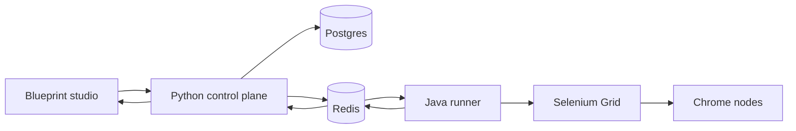

# System map

| Piece | Role |
| --- | --- |
| `frontend/` | React Flow canvas. Draws pins, saves the graph, paints live step color, shows screenshots. |
| `control-plane/` | FastAPI. Stores blueprints, validates pin types, queues jobs, schedules cron/interval, replays feedback over websockets. |
| `runner-engine/` | Java 21. One virtual thread per blueprint. Walks execution pins. Holds `WebElement`s in memory. Drives Selenium Grid. |
| Selenium Grid | `selenium/hub` and scalable `chrome-node`. Firefox is a compose profile, not the default. |
| `vault/` | Notes for later. Not read by the running app. |

Python and Java do not share a process. Redis is the boundary.

- queue: `queue:workflow_jobs` (`RPUSH` / `BLPOP`)
- feedback: `telemetry:workflow_events`

The job JSON uses camelCase because the runner is Java. The REST API and websocket events the studio sees are snake_case. The control plane translates.

## Startup

`docker compose up --build -d --scale chrome-node=2` is enough. No `.env` file is required. Defaults live in compose and in each service.

Schema is created on control-plane startup with `create_all`. There are no migrations yet. A breaking model change means `make clean` until Alembic is added. See [[Backlog]].
